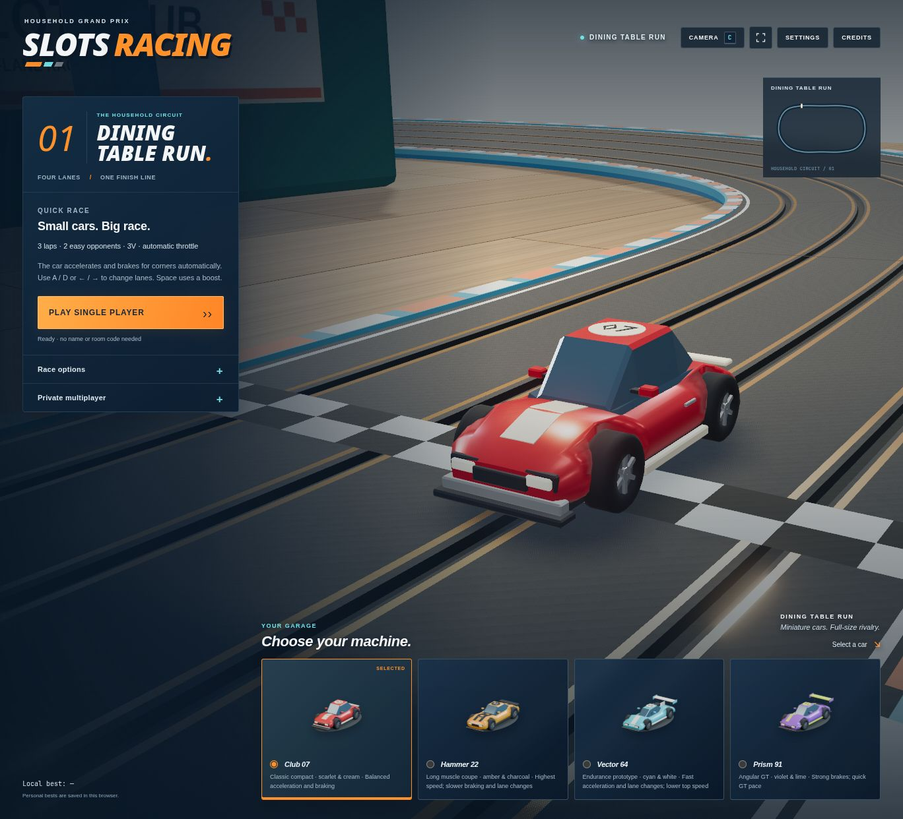
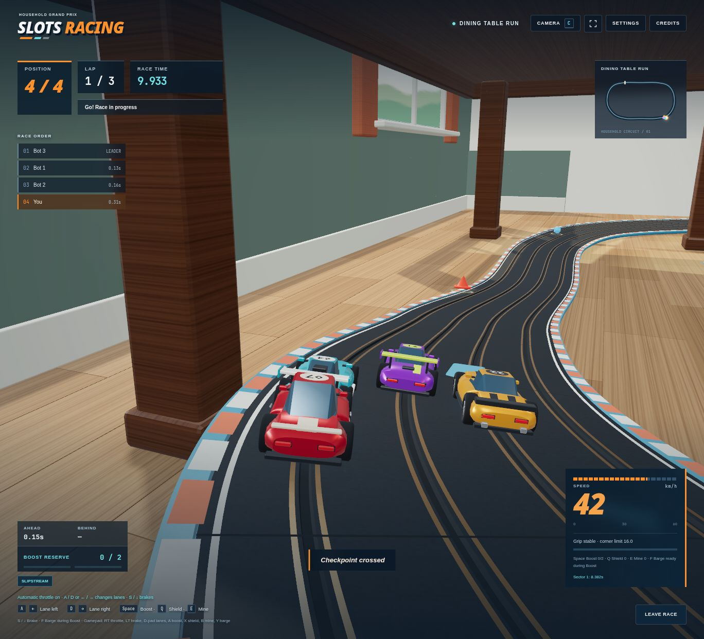
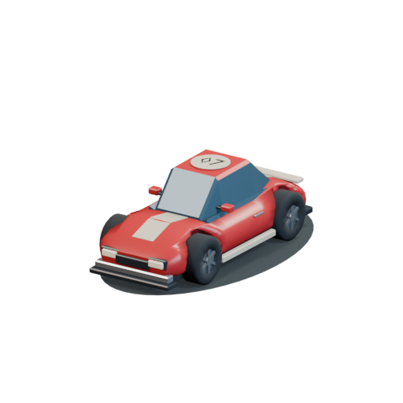
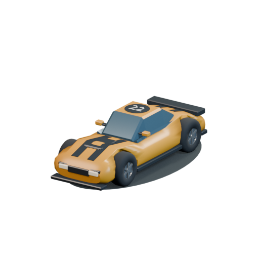
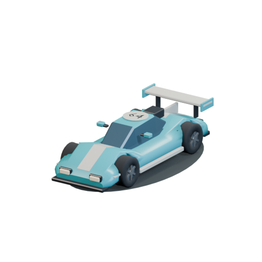
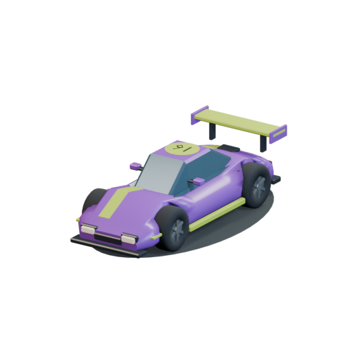

<div align="center">

<p><sub>THE HOUSEHOLD GRAND PRIX</sub></p>

# Slots Racing

**Small cars. Big race.**

A browser racer with the spirit of a living-room console classic.<br>
Four lanes, a dining-room circuit, and one more lap before you call it a night.

[The game](#a-room-becomes-a-racetrack) · [Get started](#take-the-grid) · [Controls](#at-your-fingertips) · [Under the hood](#under-the-hood)



<sub>DINING TABLE RUN · ORIGINAL CARS & CIRCUIT · BUILT WITH TYPESCRIPT & THREE.JS</sub>

</div>

## A room becomes a racetrack

Sunlight across the floorboards. A bridge beneath the dining table. A row of tiny cars waiting for the lights.

**Slots Racing** turns an ordinary room into a miniature grand prix. Pick a car, find your lane, and decide how much speed you can carry into the next corner. The presentation takes its cues from the PS2 era: readable silhouettes, warm interiors, bold menus, and an arcade HUD that keeps the race in view.



### Pick your kind of race

- **Quick race:** go straight from the garage to the grid, with one to three bots and three difficulty levels.
- **Private multiplayer:** create a room, share its code, and race with up to four drivers. Spectators can watch the action.
- **Club, Party, or Time Trial:** race with equal item odds, recovery-focused item draws, or clean laps against a personal-best ghost.
- **Dining Cup:** take on three rounds, or choose a one-, three-, or five-lap race.
- **3V, 6V, or 9V:** ease into the circuit or turn up the pace. Automatic throttle and corner braking are optional.

Boosts, shields, mines, and deliberate barge attacks give you reasons to watch the other lanes. Sector times, race gaps, and locally saved bests give you reasons to return.

### Four cars. Four ways through a corner.

| Club 07 | Hammer 22 | Vector 64 | Prism 91 |
| :---: | :---: | :---: | :---: |
|  |  |  |  |
| Balanced acceleration and braking | Highest speed; a heavier touch | Fast acceleration and lane changes | Strong brakes and quick GT pace |

## Take the grid

You’ll need **Node.js 22.12+**, **Bun 1.3.14+**, and a browser with **WebGL2**. The models and circuit are included; Blender is only needed to rebuild assets.

```sh
git clone https://github.com/Abdirrahman/slots.git
cd slots
bun install --frozen-lockfile
```

Start the race server in one terminal:

```sh
bun run server
```

Start the client in another:

```sh
bun run dev
```

Open **[localhost:5173](http://localhost:5173)** and select **Play Single Player**. The development client forwards `/ws` to the race server on port `3000`.

For a production build, run `bun run build`, then `bun run server` and open **[localhost:3000](http://localhost:3000)**. The server serves `dist/` and the WebSocket endpoint together. Both solo and multiplayer races use the server; static hosting alone does not run the game.

## At your fingertips

| Action | Keyboard | Gamepad |
| :--- | :--- | :--- |
| Throttle · when assist is off | `W` / `↑` | Right trigger |
| Brake | `S` / `↓` | Left trigger |
| Change lane | `A` / `D` or `←` / `→` | D-pad left / right |
| Boost | `Space` | A |
| Shield | `Q` | X |
| Place a mine | `E` | B |
| Barge · during boost | `F` | Y |
| Cycle chase, bonnet, and wide cameras | `C` | — |
| Close Settings or Credits | `Esc` | — |

Sound starts after an interaction. Settings include volume and mute controls; reduced-motion preferences are respected.

## Under the hood

The browser draws the world; the server decides the race. A deterministic lane-based simulation handles progress, grip, items, contact, and finishing order. Client presentation smooths movement and predicts lane changes while staying connected to that authority.

Three.js supplies the 3D scene, reflections, shadows, and restrained bloom. Web Audio synthesizes the motor, road noise, race cues, and music. Original Blender assets supply the cars and room; procedural materials add the grain, wear, and small details that make the circuit feel at home.

| Where | What you’ll find |
| :--- | :--- |
| [`src/`](src/) | Race simulation, room server, network protocol, rendering, UI, and audio |
| [`test/`](test/) | Unit and WebSocket integration tests |
| [`public/assets/`](public/assets/) | Game-ready models, circuit, and garage cards |
| [`blender/`](blender/) | Editable scenes, generation scripts, and asset validation |
| [`docs/`](docs/) | Game design, architecture decisions, research, and screenshots |

```sh
bun run typecheck
bun test
bun run build
```

The current suite contains **277 passing tests**, including real WebSocket integration checks. See the [game design](docs/game-design.md), [asset manifest](docs/ASSET_MANIFEST.md), and [asset pipeline](blender/README.md) for the details.

---

<div align="center">
<sub>FOUR LANES. ONE FINISH LINE.</sub><br>
<strong>See you on the dining-room floor.</strong>
</div>

## Dependency security

Dependabot checks dependencies and GitHub Actions weekly. The dependency checks workflow also runs `bun audit`, the available frontend checks, and a production build daily and on pull requests. This covers transitive packages in `bun.lock`, which GitHub's dependency graph does not parse.
