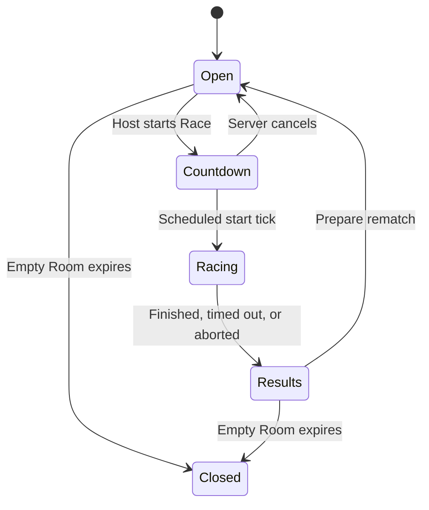

# Slots Racing implementation plan

Status: ready to begin

This plan turns the decisions in `CONTEXT.md` and `docs/adr/` into an implementation sequence. It intentionally proves the authoritative multiplayer loop early, then adds gameplay depth one mechanic at a time.

## Product target

The first complete private-session release should provide:

- One handcrafted four-Lane Track.
- Two to four human Racers using guest names and a Room code.
- One initial Car profile; visual variants may share the same profile.
- Keyboard controls for adjacent Lane changes; Cars accelerate forward automatically.
- A Host-controlled Race start, authoritative Laps and finish order, results, and rematch.
- Ordinary collisions and Blocked Lane changes.
- Boost, Shield, Hazard, Crash, Respawn, and Ghost state mechanics.
- Bot replacement for temporarily disconnected Racers.
- Spectators who join during an active Race or when racing positions are full.
- Browser-local best times with no integrity or cross-device guarantee.

Accounts, public matchmaking, persistent progression, global leaderboards, monetization, and invasive anti-cheat remain out of scope.

## Implementation defaults

These are initial implementation choices, not promises that tuning values will never change.

- Use TypeScript throughout.
- Use one npm project initially; do not create a multi-package workspace until separate deployment builds require it.
- Use a pure Race simulation module with no Three.js, DOM, WebSocket, wall-clock, or storage dependencies.
- Run the authoritative Race simulation at a fixed 30 ticks per second.
- Represent gameplay durations as integer simulation ticks.
- Use ordinary JavaScript numbers for progress, speed, and acceleration.
- Use one logical cyclic Track progress coordinate shared by all four Lanes.
- Run one Node.js server process with in-memory Rooms.
- Use JSON WebSocket messages and full authoritative snapshots initially.
- Send snapshots less frequently than simulation ticks; begin at 15 snapshots per second and tune from measurements.
- Render independently from simulation, normally at the browser frame rate.
- Keep Room mutation serialized within one process.
- Treat a server restart as ending active Rooms.
- Deploy client and server as one compatible release; reject incompatible protocol versions clearly.

Do not introduce fixed-point arithmetic, rollback netcode, binary snapshots, databases, distributed Room state, WebGPU, a Track editor, or a custom asset pipeline without measured need.

## Module seams

### Race module

Owns authoritative movement, Lane changes, interactions, effects, recovery, Checkpoints, Laps, finish timing, and Race results.

Its core interface should remain conceptually small:

```ts
advanceRace(state, inputs): {
  state: RaceState
  events: RaceEvent[]
}
```

Creation and validation helpers may exist, but callers must not mutate individual Race fields through setters.

### Room module

Owns Player membership, Racer and Spectator roles, Host capability, Room lifecycle, Race configuration, Race creation, reconnect reservations, consecutive Races, and controller changes between a human Racer and Bot.

WebSocket handlers are adapters: decode and validate a command, pass it to the Room module, then encode the result. They must not contain Race rules.

### Track module

Owns validated logical Track data: cyclic length, four Lanes, start/finish, ordered Checkpoints, Lane-change restrictions, interaction markers, Track obstacles, Hazard placement locations, and a stable Track version.

Three.js is a rendering adapter from logical Track and Race state to visual poses. Rendered mesh proximity never decides authoritative interactions.

## Authoritative simulation contract

The Race module must obey these rules from its first implementation:

- Advance only in fixed simulation ticks.
- Apply accepted control intent at a defined tick, never from browser timestamps.
- Use stable identifiers and stable ordering for same-tick processing.
- Use server-owned seeded randomness when randomness is introduced.
- Use swept progress checks so a Car cannot skip a Checkpoint, pickup, finish line, Hazard, or narrow Track obstacle between ticks.
- Process multiple crossed Track markers in logical Track order, including across the cyclic seam.
- Interpolate finish crossing within a tick instead of quantizing every result to 33 milliseconds.
- Keep presentation events separate from authoritative state.
- Produce the same result for the same initial state, Track, seed, and accepted input frames.

Initial per-tick phase order:

1. Validate and apply input intent.
2. Update effect and recovery timers.
3. Integrate speed, progress, and Lane transitions.
4. Generate and resolve interaction candidates in stable order.
5. Validate Checkpoints, Laps, finish crossings, and Race termination.
6. Apply Crash and Respawn transitions.
7. Emit Race events and publish the resulting state.

A later mechanic may require refining this order, but it must be changed deliberately with scenario tests.

## Initial control contract

For the first playable implementation:

- Cars accelerate forward automatically; players do not control throttle.
- A Lane-change request is an edge-triggered intent of `-1` or `1`.
- A request may only target an adjacent Lane within indices `0` through `3`.
- A Car cannot begin another Lane change while already transitioning or returning from a Blocked Lane change.
- There is no reverse gear or manual brake initially.
- Keyboard defaults are `A`/left arrow or `D`/right arrow for Lane changes.
- Gamepad and touch controls are deferred until keyboard play proves the control model.

Automatic acceleration, top speed, and Lane-change duration must be centralized as Car profile values rather than scattered constants.

## Room lifecycle contract

The initial Room state machine is:



Required invariants:

- A Room has at most one active Race.
- Race configuration freezes when countdown begins.
- Every Race receives a new stable `raceId`.
- Commands for an old `raceId` cannot affect a later Race.
- `start Race` is Host-authorized, valid only from `Open`, and idempotent.
- A Race ends when all participating Cars finish, the post-finish timeout expires, an absolute maximum duration expires, or the server aborts it.
- The first finisher starts the post-finish timeout; remaining Cars become DNF when it expires.
- Joining during `Countdown` or `Racing` creates a Spectator until the next Race.
- Empty Rooms expire after a server-configured interval.

Readiness voting, co-hosts, persistent Rooms, and cross-server Room migration are deferred.

## Protocol contract

Clients send intent, never authoritative state. They must not submit progress, speed, collision, pickup, Lap, Crash, or finish claims.

Every client command should carry:

- Protocol version.
- Message type.
- Monotonically increasing connection sequence.
- `raceId` when the command affects a Race.
- A strictly validated payload.

Server snapshots should carry:

- Protocol version.
- Message type.
- `raceId` where applicable.
- Authoritative simulation tick.
- State version.
- Last processed input sequence for the receiving Racer.
- Enough complete state to recover without replaying older snapshots.

Use WebSocket ordering, sequence rejection, and complete snapshots. Do not build a custom reliable transport.

## Implementation milestones

Each milestone must leave one runnable, tested vertical slice. Do not begin the next milestone while the current gate is failing.

### Milestone 1 — Headless deterministic Race core

Goal: prove the logical Track and fixed-step Race module without rendering or networking.

Implement:

- Minimal npm and strict TypeScript setup.
- A focused test runner compatible with the selected TypeScript/Vite toolchain.
- Logical Track types with cyclic length, four Lanes, start/finish, and ordered Checkpoints.
- A synthetic circular Track fixture.
- Car profile, Race configuration, Race state, Car state, and input-frame types.
- Fixed 30 Hz Race advancement.
- Automatic acceleration and top-speed clamping.
- Adjacent Lane transitions with progress represented in authoritative state.
- Swept Checkpoint and start/finish crossing.
- Lap advancement only after ordered Checkpoint validation.
- Sub-tick finish time and a finished state that occurs at most once.
- A deterministic replay-style test that runs a stored sequence of input frames twice and compares the results.

Do not implement Three.js, WebSockets, Rooms, collisions, Power-ups, Bots, assets, or persistence in this milestone.

Gate:

- Type checking passes.
- Tests pass.
- Production compilation passes.
- Tests cover Track seam crossing, ordered Checkpoints, invalid repeated Checkpoints, adjacent Lane bounds, several markers crossed in one tick, and deterministic replay.
- The Race module imports no browser, renderer, network, or storage code.

### Milestone 2 — Local grey-box browser Race

Goal: prove that logical Race state maps cleanly to a playable Three.js presentation.

Implement:

- Vite browser entry point.
- Three.js scene using generated grey-box geometry rather than external assets.
- A rendered four-Lane synthetic Track.
- Car poses sampled from logical progress, Lane, and Lane-transition progress.
- Local left/right keyboard input using the initial control contract.
- A fixed-step local harness around the same Race module used by tests.
- Native HTML/CSS countdown, Lap, finish, and restart UI.
- WebGL2 capability failure messaging.
- Keyboard focus, visible focus, semantic controls, and reduced-motion handling for camera effects.

Gate:

- One local Race can be completed and restarted.
- Rendering frame rate does not alter the final authoritative Race result for a recorded input sequence.
- Browser build and Race tests pass.
- No gameplay decision depends on Three.js geometry.

### Milestone 3 — Authoritative multiplayer tracer bullet

Goal: prove the product's highest-risk path with two browsers and one authoritative Room server.

Implement:

- One Node.js process with in-memory Rooms.
- Room creation, guest-name join, Room codes, Host start, countdown, Racing, Results, and rematch.
- A versioned JSON WebSocket protocol.
- Strict message parsing, value bounds, message-size limits, and Host authorization.
- Client input intent with sequences and `raceId`.
- Server-side Race simulation only.
- Full snapshots at an initial 15 Hz.
- Client interpolation between snapshots.
- Limited local prediction for continuous movement and Lane-change animation; authoritative correction wins.
- A clear connection-lost state.
- Integration tests using programmatic WebSocket clients for create, join, start, stale command rejection, finish, and rematch.

Keep this milestone to movement, Lane changes, Checkpoints, Laps, and results. Temporary Car overlap is acceptable until Milestone 4; do not add an improvised collision system inside the network adapter.

Gate:

- Two browser tabs can join the same Room and complete one Race with identical results.
- Clients cannot submit authoritative Car state.
- Duplicate sequences and commands for an old Race are ignored.
- Server, protocol integration, Race, and browser builds pass.

### Milestone 4 — Contact and core multiplayer playable

Goal: make multi-Car racing mechanically coherent.

Before coding, add a concise collision truth table to the gameplay specification covering rear contact, Lane-transition conflicts, simultaneous exchanges, same-destination claims, and three-Car chains.

Implement:

- Swept Car-to-Car contact detection using logical progress and Lane occupancy.
- Ordinary collisions as contact-entry events so speed loss is not applied every tick.
- A minimum longitudinal gap while contact persists.
- Blocked Lane changes with authoritative return state.
- Batch resolution for simultaneous Lane claims so array order cannot choose a winner.
- Stable resolution of three- and four-Car chains.
- Results and rematch UI appropriate for two to four Racers.
- A minimal disconnect policy: a disconnected Car receives no new human input and the Race remains bounded by its maximum duration.

Gate:

- Collision outcomes are unchanged when Car storage order is permuted.
- Continuous contact does not repeatedly apply collision speed loss.
- Simultaneous Lane exchanges and same-destination claims have explicit tested outcomes.
- A deployed two-machine private-session smoke test succeeds.

### Milestone 5 — Crash, recovery, and Power-ups

Goal: add the remaining arcade mechanics through the same authoritative path.

Implement in this order, completing tests and presentation for each before starting the next:

1. Fixed Track obstacles and Crash.
2. Shared recovery delay, safest-Lane Respawn, and Ghost state.
3. Power-up opportunities with deterministic one-Car collection.
4. Shield and one-impact consumption.
5. Boost and Boosted impacts.
6. Authored Hazard placement locations, telegraphing, activation, collision, and cleanup.

Required decisions captured in a gameplay specification before each mechanic:

- Whether active effects survive a Crash.
- What Respawn speed means.
- Which interactions a ghosted Car may perform.
- Exact clear-position and safest-Lane rules.
- Shield behavior for multiple same-tick impacts.
- Whether Boost ends after a Boosted impact.
- Hazard warning duration, lifetime, viable-Lane rule, and no-valid-placement behavior.

Use server-owned seeded randomness. Prefer authored Hazard placement locations over arbitrary random Track positions.

Gate:

- Same seed and input stream produce the same Power-up and Hazard outcomes.
- A solid Hazard never creates a state with no viable Lane.
- All four Lanes occupied at Respawn is handled without deadlock.
- Shield, Boosted impact, Crash, Respawn, and Ghost state interactions have scenario tests.

### Milestone 6 — Resilient Rooms, Bots, and Spectators

Goal: make private sessions survive normal browser and connection behavior.

Implement:

- A high-entropy Room-scoped reconnect token separate from the Room code.
- Stable Player membership and stable participating Car identity across controller changes.
- One active connection generation per Player.
- Input heartbeat or lease so a half-open human connection transfers deterministically to a Bot.
- Bot takeover at a simulation-tick boundary after disconnect.
- Human reclaim at a defined tick boundary after reconnect and full snapshot.
- A deterministic baseline Bot that emits the same input intent as a human Racer.
- Host transfer.
- Spectator snapshots with no Race-control capability.
- Room connection and Spectator limits.
- Empty-Room expiration.

The Bot should use a small Lane lookahead scorer with reaction delay and deterministic mistakes. Do not build pathfinding infrastructure.

At this milestone, resolve and add a canonical glossary term for the persistent participation record whose Car continues while control changes between a human Racer and Bot.

Gate:

- Refresh restores the same Player membership and participating Car without replaying stale input.
- Two sockets cannot simultaneously control one Car.
- Half-open input eventually transfers to a Bot.
- A Bot cannot mutate Race state except through ordinary input intent.
- Host loss cannot leave the Room permanently unmanageable.

### Milestone 7 — Authored content and presentation

Goal: replace the synthetic presentation with one coherent, licensed, performant Track experience.

Implement:

- A validated authored Track data file with stable version or content hash.
- One handcrafted Track connected to the logical Track contract.
- Original or explicitly licensed Car, Track, UI, font, and audio assets.
- An asset manifest recording source, creator, terms, attribution, modifications, and usage.
- Required in-product credits.
- Camera, audio, effects, and feedback for every authoritative Race event.
- The gameplay depth the authored Track makes possible: authored per-Lane corner speed limits and de-slotting (ADR 0007), slipstream, a Boost economy the Racer spends, a HUD carrying position, gaps, charges and effects, and Bot difficulty expressed as racecraft. Every one of these is a new authoritative rule, so each needs its truth table in `docs/game-design.md` and deterministic tests before the gate.
- Browser-local best times keyed by Track version, Race configuration, and Car profile, with no integrity guarantee.
- Keyboard-accessible Room/settings/results flows, mute/volume controls, non-color-only Racer identification, and reduced-motion behavior.

Start with GLB and ordinary web texture/audio formats. Add compression only if measured download or GPU budgets require it.

Gate:

- Every shipped third-party asset has a complete manifest entry and required attribution.
- Track data validation runs during tests or build.
- A complete Race works on the chosen integrated-GPU reference machine.
- A default Race lasts minutes rather than seconds, and its measured Lap and Race times are recorded in the design document.
- Browser-local records are invalidated or separated when the Track version or relevant Race configuration changes.

### Milestone 8 — Internet hardening and release

Goal: make the private-session release safe and diagnosable enough for invited players.

Implement:

- HTTPS/WSS deployment.
- WebSocket Origin validation.
- Cryptographically secure Room codes with measured enumeration resistance.
- Rate limits for Room creation, joins, and malformed or excessive messages.
- Guest-name normalization, bounds, and text-only rendering.
- Redaction of Room codes and reconnect tokens from logs.
- Bounded outbound queues; stale snapshots may be replaced by newer snapshots.
- Health and readiness endpoints.
- Aggregate operational logs and metrics for Room/Race lifecycle, tick lag, event-loop lag, connections, snapshot size, rejections, and backpressure.
- Clear client behavior for server restart and protocol incompatibility.
- Conservative admission limits based on a load test.
- A rollback procedure for the previous compatible deployment.

Gate:

- Production build, type checking, tests, asset validation, and protocol integration pass in CI.
- A two-machine WSS smoke test succeeds.
- Repeated Room creation and expiration do not show unbounded memory growth.
- Slow or malicious clients cannot create unbounded server queues.
- The server remains within its tick budget at the intended initial Room count.

## Test strategy

Prefer tests at the module interfaces rather than through internal helpers.

Minimum layers:

1. Race scenario tests for deterministic rules and edge cases.
2. Room transition tests for authorization, lifecycle, reconnect, and controller changes.
3. Protocol integration tests using real WebSocket connections to a test server.
4. One browser end-to-end path for create, join, start, Race, results, and rematch once the flow stabilizes.
5. Manual deployed smoke and reference-device performance checks.

High-value scenarios include:

- Several Track markers crossed in one tick.
- Two Cars exchanging Lanes simultaneously.
- Three-Car Ordinary collision chains.
- Shield pickup and Boosted impact in the same tick.
- Two otherwise crashing impacts against one Shield in the same tick.
- Hazard placement across the cyclic Track seam.
- All four Lanes occupied at Respawn.
- A ghosted Car crossing the finish.
- Two Cars finishing within one simulation tick.
- Nobody finishing before maximum Race duration.
- Host disconnect during countdown.
- Racer refresh during a Race and Bot takeover.
- An old command arriving after rematch begins.
- Two Players choosing the same guest name.
- A Spectator that stops reading snapshots.
- Temporary server tick lag.

## Deliberate deferrals

Do not add these while the milestone gates can be met without them:

- General rigid-body gameplay physics.
- Server rollback or rewind.
- Fixed-point simulation.
- Binary or delta-compressed protocol.
- Persistent Room state or Race recovery after restart.
- Horizontal scaling or multi-region deployment.
- Public matchmaking, accounts, progression, or global records.
- Durable moderation or ban systems.
- Sophisticated Bot pathfinding.
- Procedural Tracks or a Track editor.
- WebGPU or native applications.
- Custom asset-management infrastructure.
- Mobile/touch support, unless the intended friend group requires it before release.

## Prompt for the next implementation agent

```text
You are implementing Slots Racing in `/home/am/slots`.

Read these files before editing:

- `CONTEXT.md`
- every ADR in `docs/adr/`
- `docs/IMPLEMENTATION_PLAN.md`

Implement **Milestone 1 — Headless deterministic Race core** from the implementation plan. Do not begin Milestone 2 and do not add Three.js, Vite browser UI, WebSockets, Rooms, collisions, Power-ups, Bots, assets, storage, or deployment code.

The repository currently contains documentation only, so establish the minimum npm/TypeScript project needed for this milestone. Inspect the installed Node/npm versions before selecting tool versions. Use strict TypeScript and a small test runner compatible with the future Vite TypeScript stack. Avoid a monorepo, package workspaces, framework scaffolding, and speculative interfaces.

Build a pure Race module with no DOM, Three.js, WebSocket, wall-clock, random-global, or storage dependencies. It must include:

- logical Track types with one cyclic progress coordinate, exactly four Lanes, start/finish, and ordered Checkpoints;
- one synthetic circular Track fixture;
- Car profile, Race configuration, Race state, Car state, and per-tick input types;
- fixed 30 Hz advancement;
- automatic acceleration and top-speed clamping through centralized Car profile values;
- edge-triggered adjacent Lane changes using `-1 | 1`, with Lane-transition progress in authoritative state;
- swept Checkpoint and start/finish crossing, including wraparound and multiple markers in one tick;
- Lap advancement only after Checkpoints are validated in order;
- sub-tick finish timing and protection against finishing more than once;
- deterministic results for identical initial state and input frames.

Keep the external Race interface small. Prefer a function shaped like `advanceRace(state, inputs) -> { state, events }`, plus only the creation/validation functions actually required. Return new results rather than coupling the module to rendering or network side effects.

Add focused tests covering:

- deterministic replay of the same input frames;
- cyclic Track seam crossing;
- Checkpoints validated in order;
- repeated or out-of-order Checkpoints not advancing a Lap;
- several markers crossed in one tick;
- Lane indices staying within `0..3` and changes remaining adjacent;
- Lane changes taking authoritative simulation time;
- top-speed clamping and non-negative finite speed;
- sub-tick finish timing;
- a Car finishing at most once.

Use provisional tuning values where needed, centralize them, and avoid presenting them as final game balance. Update the Milestone 1 section of `docs/IMPLEMENTATION_PLAN.md` only if implementation reveals a necessary correction; do not broaden scope.

Before finishing, run the repository's type-check, test, and production compilation commands. Fix issues caused by your changes. Report:

1. files and modules created;
2. the Race module interface and invariants;
3. commands run and their results;
4. any explicit assumptions or deferred questions for Milestone 2.
```
